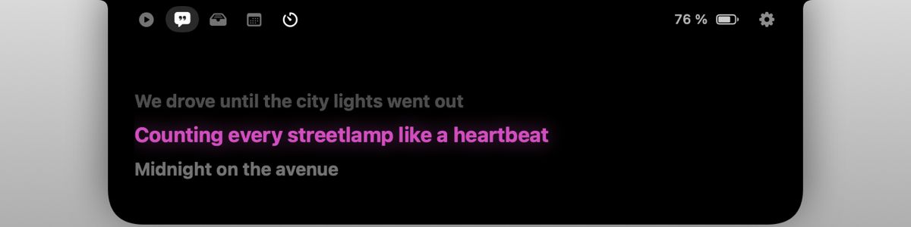
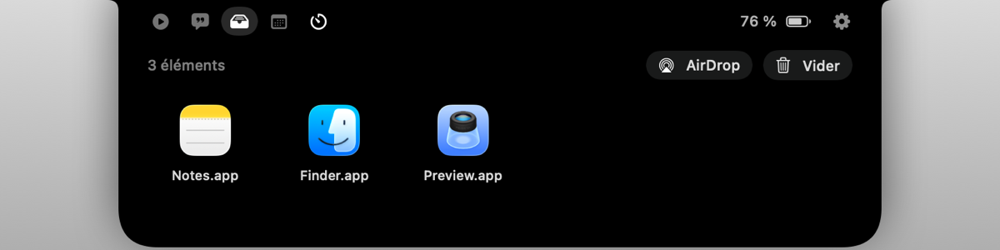
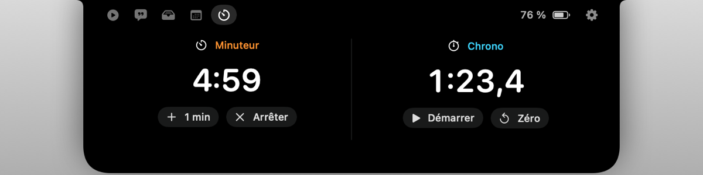
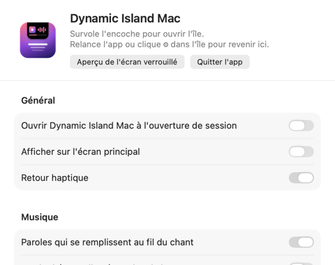

<p align="center">
  
</p>

<h1 align="center">Dynamic Island Mac</h1>

<p align="center">
  <strong>Ton encoche prend vie.</strong><br>
  Ta musique, tes paroles, tes fichiers et ton agenda dans une île qui s'ouvre au survol,<br>
  et un lecteur en verre jusque sur l'écran verrouillé.
</p>

<p align="center">
  
  
  
</p>

<p align="center">
  <a href="#installer"><strong>Installer</strong></a>
  &nbsp;·&nbsp;
  <a href="#ce-que-fait-lîle">Voir ce qu'elle fait</a>
  &nbsp;·&nbsp;
  <a href="#les-réglages">Les réglages</a>
</p>

<p align="center">
  
</p>

---

## Ce que fait l'île

- **Elle s'ouvre au survol.** Passe la souris sur l'encoche : l'île se déplie avec un ressort et se replie quand tu t'éloignes. Pas d'encoche ? Elle dessine la sienne.
- **Elle joue ta musique.** Spotify et Musique : pochette, titre, barre de lecture que tu peux faire glisser, aléatoire, répétition, et le choix de la sortie audio (haut-parleurs, AirPods, écran, AirPlay).
- **Elle chante avec toi.** Les paroles se remplissent au fil du chant, et l'onglet Paroles les fait défiler. Un clic sur une ligne y saute.
- **Elle garde tes fichiers.** Dépose un fichier sur l'île : il attend sur l'étagère jusqu'à ce que tu le glisses ailleurs ou l'envoies par AirDrop.
- **Elle connaît ta journée.** Prochains rendez-vous, météo, minuteur et chrono, toujours à portée de souris.
- **Elle te prévient.** Chargeur branché, batterie faible, AirPods connectés, volume, fin du minuteur : l'île s'élargit un instant, puis se fait oublier.

<p align="center">
  <br>
  
</p>

| Paroles | Étagère |
|---|---|
|  |  |
| **Agenda** | **Minuteur et chrono** |
|  |  |

## Sur l'écran verrouillé

Quand tu verrouilles ton Mac (⌃⌘Q), la météo, la batterie et ton prochain rendez-vous s'affichent sous l'horloge, avec un lecteur en verre pour piloter la musique. Tu peux agrandir la pochette et monter ou descendre la carte. L'horloge de macOS et le champ du mot de passe restent visibles, et c'est toujours macOS qui déverrouille.

> [!NOTE]
> L'écran verrouillé passe par une API privée de macOS. Elle peut cesser de fonctionner après une mise à jour du système : l'option se désactive dans les réglages.

## Installer

Il faut macOS 14 ou plus récent et les outils de ligne de commande d'Xcode (`xcode-select --install`).

```bash
git clone https://github.com/AkCoooo/dynamic-island-mac.git
cd dynamic-island-mac
./scripts/install.sh
```

Le script compile, emballe `Dynamic Island Mac.app` avec son icône, la signe, l'installe dans `~/Applications` et la lance. Tu la retrouves ensuite dans le Launchpad et dans Spotlight, comme n'importe quelle app.

Au premier lancement, les réglages s'ouvrent pour te montrer où tout se trouve.

## Les réglages



Trois chemins y mènent :

- **Relance l'app** depuis le Launchpad, Spotlight ou le dossier Applications.
- **Clique sur ⚙** en haut à droite de l'île ouverte.
- **Clique sur le logo de l'île** dans la barre des menus, puis sur **Réglages…** Tu peux masquer ce logo dans les réglages : les deux autres chemins suffisent.

Tu y choisis l'apparence de l'île (Noir ou Verre), le délai d'ouverture, les notifications, les options de l'écran verrouillé, les coins arrondis en bas de l'écran, la ville pour la météo et le lancement à l'ouverture de session.

<br clear="right">

## Autorisations

macOS te les demande une fois, au moment où l'app en a besoin :

| Autorisation | Pourquoi |
|---|---|
| **Automatisation** (Spotify, Musique) | Lire le morceau en cours et piloter la lecture |
| **Bluetooth** | Voir quand tes écouteurs se connectent |
| **Calendriers** | Afficher tes prochains rendez-vous |
| **Position** | La météo de là où tu es (inutile si tu saisis une ville) |

Ni l'Accessibilité, ni l'enregistrement de l'écran ne sont nécessaires.

## Ce qu'elle ne fait pas (encore)

- **La batterie des AirPods** n'a pas d'API publique : l'île l'affiche quand macOS la fournit, sinon elle écrit « Connecté ».
- **Les autres lecteurs** (navigateurs, Tidal…) ne sont pas suivis : macOS réserve cette information aux apps d'Apple.
- **Le HUD de volume de macOS** reste affiché en plus de celui de l'île.

## Sous le capot

| Fichier | Rôle |
|---|---|
| `NotchWindowController.swift` | La vitre transparente posée sur l'encoche, et le survol |
| `NotchView.swift` | La forme de l'île, ses onglets et toutes ses vues |
| `NotchModel.swift` | L'état partagé : mode, taille, morceau, minuteur, étagère |
| `NowPlayingService.swift` | Spotify et Musique, pochettes, commandes |
| `LyricsService.swift` | Les paroles synchronisées, depuis [LRCLIB](https://lrclib.net) |
| `LockScreen.swift` | Les widgets et le lecteur de l'écran verrouillé |
| `AudioOutputs.swift`, `VolumeMonitor.swift` | Sorties audio et volume (Core Audio) |
| `SystemMonitors.swift` | Batterie et écouteurs Bluetooth |
| `AgendaWeather.swift` | Agenda (EventKit) et météo ([Open-Meteo](https://open-meteo.com)) |
| `Settings.swift` | Les réglages et leur fenêtre |
| `CornerOverlay.swift`, `KeepAwake.swift` | Coins arrondis, écran gardé allumé |
| `Snapshot.swift` | Rendu des écrans en PNG, pour vérifier le design sans écran |

Pour régénérer les captures : `swift build && .build/debug/DynamicIslandMac --snapshot /tmp/captures`.
